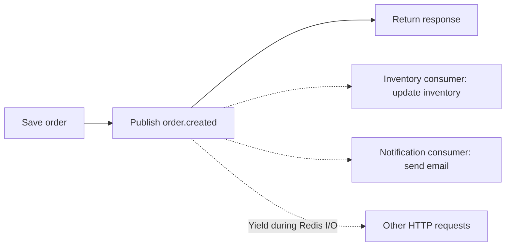

# streambus

[](https://pypi.org/project/streambus/)
[](https://pypi.org/project/streambus/)
[](https://www.python.org/)
[](LICENSE)
[](https://github.com/jmeiracorbal/streambus/actions/workflows/release.yml)
[](#development)

Lightweight event bus over Redis Streams. Define typed events, publish from one service, consume in others without boilerplate or framework dependencies.

## Install

```bash
pip install streambus
```

```bash
uv add streambus
```

## Quick start

Define an event:

```python
from dataclasses import dataclass
from streambus import StreamBusEvent

@dataclass(kw_only=True)
class OrderCreated(StreamBusEvent):
    order_id: str
    customer_id: str
    total: str
```

Publish it:

```python
from streambus import EventPublisher, RedisConfig, RedisStreamsTransport

transport = RedisStreamsTransport(RedisConfig(url="redis://localhost:6379"))
publisher = EventPublisher(stream="orders:events", transport=transport)

publisher.publish(
    OrderCreated(
        event_type="order.created",
        order_id="ord_123",
        customer_id="cust_456",
        total="99.90",
    )
)
```

Consume it:

```python
from streambus import EventListener, RedisConfig, RedisStreamsTransport

def handle_order(event: OrderCreated) -> None:
    print(f"New order {event.order_id}: total {event.total}")

EventListener(
    stream="orders:events",
    group="notifications",
    handler=handle_order,
    event_class=OrderCreated,
    transport=RedisStreamsTransport(RedisConfig(url="redis://localhost:6379")),
).run()
```

## Synchronous vs asynchronous order processing

Consider a checkout flow that saves an order, updates inventory, and sends a confirmation email.

### Synchronous processing


**Blocking operations run sequentially.** The request waits for every step to finish before returning a response.

```python
def place_order(order: OrderCreated) -> None:
    save_order(order)
    update_inventory(order)
    send_confirmation_email(order)
```

Here, `save_order`, `update_inventory`, and `send_confirmation_email` represent application-defined blocking operations.

### Asynchronous event processing



**The producer waits only for Redis to accept the event, not for the consumers to finish.** Two independent consumer groups can process the inventory update and email notification concurrently. During awaited I/O, the event loop can also serve other requests.

```python
import asyncio
from streambus import (
    AsyncEventListener,
    AsyncEventPublisher,
    AsyncRedisStreamsTransport,
    RedisConfig,
)

config = RedisConfig(url="redis://localhost:6379")
publisher = AsyncEventPublisher(
    stream="orders:events",
    transport=AsyncRedisStreamsTransport(config),
)

# HTTP request handler: these two awaits are sequential.
async def place_order(order: OrderCreated) -> None:
    await save_order(order)
    await publisher.publish(order)

# Independent workers, not called by place_order().
async def on_inventory(event: OrderCreated) -> None:
    await update_inventory(event)

async def on_notification(event: OrderCreated) -> None:
    await send_confirmation_email(event)

async def run_workers() -> None:
    inventory = AsyncEventListener(
        stream="orders:events",
        group="inventory",
        handler=on_inventory,
        event_class=OrderCreated,
        transport=AsyncRedisStreamsTransport(config),
    )
    notifications = AsyncEventListener(
        stream="orders:events",
        group="notifications",
        handler=on_notification,
        event_class=OrderCreated,
        transport=AsyncRedisStreamsTransport(config),
    )
    await asyncio.gather(inventory.run(), notifications.run())
```

The `OrderCreated` event is defined in [Quick start](#quick-start); the storage, inventory, and email functions are application-defined async I/O functions. Run `run_workers()` separately from the HTTP request handler, for example in a worker process.

**Important:** `await save_order(order)` completes before `await publisher.publish(order)` starts. `await` does not automatically launch both operations in parallel. Each `AsyncEventListener` also awaits its own messages sequentially; the separate consumer groups above can progress independently.

Both synchronous and asynchronous Streambus APIs support event-driven decoupling: `EventPublisher` / `EventListener` use blocking I/O, while `AsyncEventPublisher` / `AsyncEventListener` use non-blocking I/O with `asyncio`. This example compares an *inline synchronous workflow* with an *event-driven asynchronous workflow*, not two identical architectures. As delivery is at least once, consumer handlers must be idempotent.

## Async support

The asynchronous listener also recovers idle pending messages using Redis `XAUTOCLAIM` before reading new events. Set `pending_idle_ms` (default: `60000`) on `AsyncEventListener` to configure the minimum idle time. As with the synchronous listener, handlers must be idempotent.

streambus ships async-native counterparts for both publisher and listener. They share the same API as the sync versions — the only difference is `async def` and `await`.

```python
import asyncio
from streambus import AsyncEventListener, AsyncEventPublisher, AsyncRedisStreamsTransport, RedisConfig

transport = AsyncRedisStreamsTransport(RedisConfig(url="redis://localhost:6379"))

# Publish
publisher = AsyncEventPublisher(stream="orders:events", transport=transport)
await publisher.publish(OrderCreated(event_type="order.created", order_id="123", ...))

# Consume
async def handle_order(event: OrderCreated) -> None:
    await db.save(event)

await AsyncEventListener(
    stream="orders:events",
    group="notifications",
    handler=handle_order,
    event_class=OrderCreated,
    transport=transport,
).run()
```

Run multiple listeners alongside an HTTP server in the same event loop:

```python
async def main():
    transport = AsyncRedisStreamsTransport(RedisConfig(url="redis://localhost:6379"))
    await asyncio.gather(
        AsyncEventListener(stream="orders:events", ..., transport=transport).run(),
        AsyncEventListener(stream="users:events", ..., transport=transport).run(),
        my_http_server(),
    )

asyncio.run(main())
```

## Package structure

- `streambus/publishers/`: synchronous and asynchronous event publishing.
- `streambus/consumers/`: synchronous and asynchronous event consumption and acknowledgement.
- `streambus/transports/`: transport protocols and Redis Streams implementations.

The public imports remain available directly from `streambus`. Direct imports of internal modules must use the new package paths.

## How it works

streambus uses [Redis Streams](https://redis.io/docs/data-types/streams/) for transport: persistent storage, consumer groups, and at-least-once delivery. The library manages group creation, the blocking read loop, message acknowledgement, and automatic reconnection on connection loss.

Each consumer group processes events independently. Delivery is at least once: unacknowledged messages can be redelivered, so handlers must be idempotent. The listener reclaims idle pending entries using Redis XAUTOCLAIM before reading new entries (Redis 6.2+ required).

## Events

All events extend `StreamBusEvent`:

| Field | Type | Required | Notes |
|---|---|---|---|
| `event_type` | `str` | yes | Identifies the event. Convention: `noun.verb` |
| `occurred_at` | `str` | no | ISO 8601 timestamp. Auto-set on creation. |

Subclasses declare only the fields they need. Unknown fields arriving from the stream are silently discarded — each consumer maps what it uses, nothing more.

Both `StreamBusEvent` and its subclasses must use `@dataclass(kw_only=True)`. This is required: the base class has a field with a default (`occurred_at`), and `kw_only=True` prevents the ordering conflict that would otherwise block subclasses from adding required fields.

## Configuration

**RedisConfig**

```python
RedisConfig(
    url="redis://localhost:6379",  # required
    socket_timeout=None,           # None = no timeout (correct for blocking reads)
    socket_connect_timeout=5.0,    # seconds to wait on initial connect
)
```

**EventListener**

```python
EventListener(
    stream="stream:name",     # required
    group="consumer-group",   # required
    handler=my_handler,       # required — callable(event) -> None
    event_class=MyEvent,      # required — must subclass StreamBusEvent
    transport=RedisStreamsTransport(RedisConfig(...)),  # required
    consumer=None,            # defaults to "{group}-1"
    batch_size=10,
    block_ms=5000,
    retry_delay=3.0,
    pending_idle_ms=60000,  # minimum idle time before retrying pending entries
)
```

**EventPublisher**

```python
EventPublisher(
    stream="stream:name",    # required
    transport=RedisStreamsTransport(RedisConfig(...)), # required
)
```

## Exceptions

| Exception | When |
|---|---|
| `ConfigurationError` | Invalid or missing parameters at construction time |
| `EventValidationError` | `publish()` receives a non-`StreamBusEvent` or empty `event_type` |
| `StreambusError` | Base class for all streambus exceptions |

## Development

```bash
git clone https://github.com/jmeiracorbal/streambus
cd streambus
uv sync --group dev
uv run pytest tests/ -v
```

Run the example (requires Docker):

```bash
cd example
docker compose up -d        # start Redis
uv sync
uv run python consume.py    # terminal 1
uv run python publish.py    # terminal 2
```

## License

MIT
